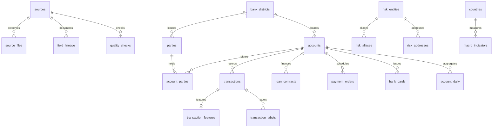

# FedShield金融数据库与数据工程

更新：2026年11月11日。入口：数据资产 → 金融数据库。

## 数据范围

| 业务域 | 本机入库规模 | 用途与边界 |
|---|---:|---|
| 匿名银行流水 | 1,056,320笔 | PKDD99真实历史银行数据；关联4,500账户、5,369客户、682贷款合同、持卡和常设支付指令。对手国家未知，不编成跨境流水。 |
| 欧洲匿名信用卡 | 284,807笔 | 原始Class含492笔欺诈标签；PCA特征、标签独立存储。原镜像未明确金额币种，保持NULL，不擅自换汇或补客户身份。 |
| 电商零售订单 | 25,900份 | 原541,909条明细按发票聚合，保留取消和非正金额；仅作为电商场景的一部分。 |
| 央行参考汇率 | 221,876条 | ECB历史序列，覆盖42种历史币种（含EUR）；不代表当前全部币种，也不是交易报价。 |
| 全球个人汇款统计 | 11,284条 | 2000—2025年国家/经济体年度收入、支出，196个经济体至少有一个非空观测。剔除区域汇总，NULL不填0，不生成虚构逐笔或双边流量。 |
| 风险名单 | 19,563主体、20,232别名 | OFAC官方快照及地址。精确规范化姓名仅返回候选，不认定同一主体，不自动阻断匿名交易。 |

金融流水与信用卡合计1,341,127笔，零售订单单独计数。上述来源跨时间、业务粒度不同，不混为同一批实时全球支付数据。

## 自建的数据模型

本地数据库：`instance/financial_data/fedshield_finance.sqlite`，约1.06GB。数据库引擎为SQLite，使用SQL查询、主键、外键和索引；运行时无需连接外部银行或大学服务器。业务用户、授权材料、流程等继续保存在独立`instance/fedshield.db`。

DDL见`backend/engine/financial_schema.sql`。共23张表：

- 主体与银行关系：`parties`、`accounts`、`account_parties`、`bank_districts`、`bank_cards`、`loan_contracts`、`payment_orders`。
- 统一金融事件：`transactions`；原币十进制值、可确认的最小单位金额、日期精度、来源键、原始记录定位分别保存。
- 模型输入与真值：`transaction_features`、`transaction_labels`。Class不会进入模型输入。
- 参考与风险数据：`countries`、`exchange_rates`、`macro_indicators`、`risk_entities`、`risk_aliases`、`risk_addresses`。
- 派生分析：`account_daily`，按原账户和日期汇总流入、流出及日内余额范围。
- 数据治理：`sources`、`source_files`、`ingestion_runs`、`quality_checks`、`field_lineage`、`warehouse_metadata`。



匿名标识加来源命名空间，不把不同数据集的匿名客户强行合成同一个人。零售主体按来源客户编号及观察国家分组，不把分组数当实际人数。银行账户与客户依原始disp关系关联，地区键统一命名空间并有外键约束。

## 数据如何取得、处理和核验

1. 固定公开来源下载，原始文件、采集时间和SHA-256保存在本地。金融记录没有随机扩增。
2. CTU公开SQL库取得账户、客户等表及20万笔流水。完整流水采用固定Git提交的原始格式镜像，逐笔与这20万笔大学库记录交叉核对。发现CTU版本部分金额舍入为整数，因此完整流水保留原镜像的分精度，并记录版本差异；不声称两个版本金额字节相同。
3. 校验全部必需文件、旁车元数据和八张银行表；重算实际SHA、字节数、行数，缺项或不匹配时拒绝建库。
4. 原始快照→来源命名空间→主体/账户/事件标准表→特征与标签→账户日汇总。币种、地理、精度缺失保持缺失，原始内容可回查。
5. 临时库构建完成后执行外键及SQLite完整性检查，通过后发布。保留原有业务库及用户文件。

主要来源：

- [CTU金融数据说明及SQL入口](https://relational.fel.cvut.cz/dataset/Financial)
- [银行原始镜像固定版本](https://github.com/jlacko/berka-dataset/tree/77e9972a1ead107e5f42a91dd989d587bff055a4)
- [ULB/Worldline信用卡数据元数据](https://www.openml.org/api/v1/json/data/1597)
- [UCI Online Retail](https://archive.ics.uci.edu/dataset/352/online-retail)
- [ECB参考汇率](https://www.ecb.europa.eu/stats/policy_and_exchange_rates/euro_reference_exchange_rates/html/index.en.html)
- [世界银行个人汇款](https://data.worldbank.org/indicator/BX.TRF.PWKR.CD.DT)
- [OFAC名单](https://ofac.treasury.gov/specially-designated-nationals-list-sdn-list)

公开可下载不等于明确允许商业再分发。UCI、WB记录CC BY 4.0；OpenML元数据仅标Public、银行版本没有统一开放许可证，当前保留本机研究来源说明，提交材料不打包这些原始数据文件。

## 真实标签模型验证

HistGradientBoostingClassifier使用V1—V28、Amount、相对Time训练；不使用Class或来源序号作特征。保留全部原始记录，建模时排除1,081条重复特征记录，避免相同样本跨分区。

按时间独立划分170,235训练、56,745校准、56,746测试。阈值只在校准集按F1选择。测试集含74笔欺诈：识别50，漏检24，误报5；PR-AUC 0.7703、ROC-AUC 0.9833、精确率90.91%、召回率67.57%。这些是历史基准结果，不是生产全球支付识别承诺；不以高总体准确率掩盖漏检。

模型、指标和预测按不可变版本目录保存，全部完成后原子切换指针。API核对当前仓库源摘要、指标摘要、预测库源摘要和版本；不一致时不展示旧结果。分值未校准为实际欺诈概率，记录详情标明训练、校准、测试或重复样本分区。

银行流水尚未部署专用识别模型，在工作台转人工；不把信用卡PCA模型或零售模型套到银行数据。银行流水可在工作台选源，参与材料预检、分级保护和报告，报告保留来源及快照摘要。

## 本机复现

在仓库目录执行：

```powershell
python tools/download_financial_sources.py
python tools/download_berka_bank.py --metadata-only
python tools/download_berka_transactions.py --reference-only
# 七张小表及大学库参考流水取得后，核对固定镜像：
python tools/download_berka_mirror.py
python tools/build_financial_warehouse.py
python tools/train_financial_card_model.py
python run.py
```

镜像核对脚本要求已有至少10,000条大学导出参考记录；本轮实际核对200,000条。`download_berka_transactions.py`提供压缩分批导出路径，网络不稳时保留已完成块，不把不完整数据发布为完整库。原始UCI库的首次构建仍使用`tools/import_public_transactions.py`。

API：`/api/finance/overview`、`sources/<id>`、`transactions`、`transactions/<id>`、`accounts/<id>`、`fx`、`fx/convert`、`macro`、`screen`、`model`、`schema`。均需登录，只读访问公开仓库；筛查和折算不会写入交易或发起付款。

## 向老师展示的顺序

1. 金融数据库总览：六类来源及按类型区分的数量。
2. 银行流水→关联账户2→账户所有人与授权操作人→贷款合同→账户日汇总。
3. 信用卡公开标签→原始PCA特征与模型分区→独立留出指标。
4. 参考汇率用历史日期折算，展示有效日期与原币保持不变。
5. 全球汇款年度统计，说明国家覆盖来自宏观数据，不冒充逐笔跨境流水。
6. 名单候选及别名→来源与血缘→23表结构及外键。

本轮41项自动回归通过，真实库接口及1600/1024/390宽度浏览器检查通过。记录保存在`_mycheck/teacher_audio_revision/finance-*.json`及日志。
